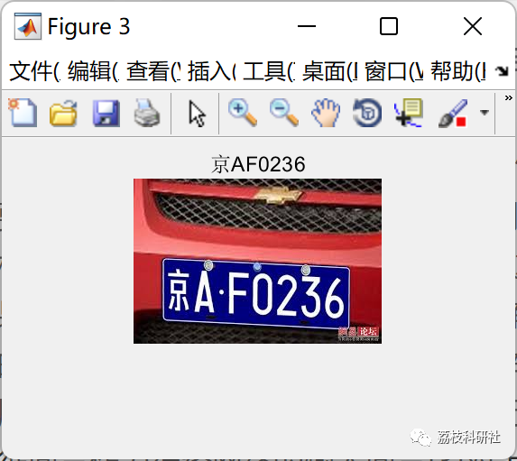
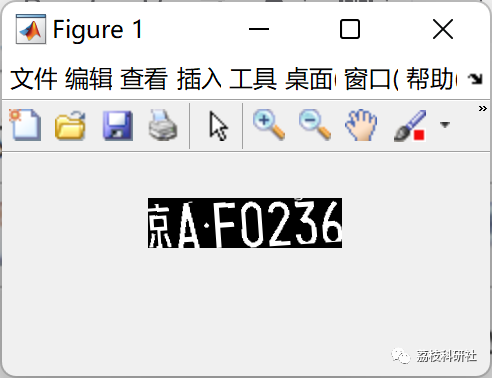
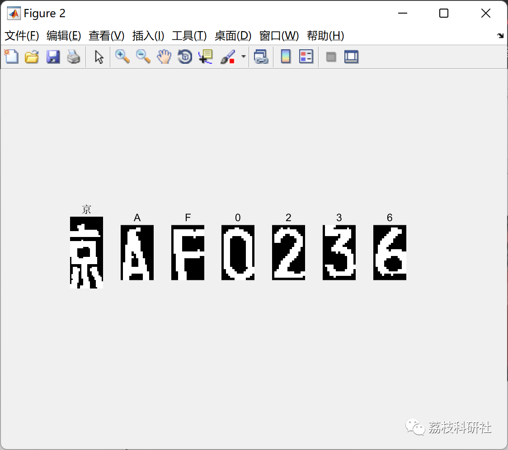

# License Plate Recognition System Based on BP Neural Network (Matlab Code Implementation)

Explain:
License Plate Recognition System Based on BP Neural Network (Matlab Code Implementation)
💥💥💥💞💞💞💞 Welcome to this blog❤️❤️❤️💥💥💥
🏆 Bloggers' Advantage: 🌞🌞🌞 The content of the blog strives to be rigorous in thought and clear in logic, for the convenience of readers.
⛳️ Mantra: The journey of a hundred miles is half done in the last ninety.
Litchi Research Society
Code Collection: Power System, Intelligent Algorithms and Applications, Neural Network Prediction, Path Planning, Optimized Scheduling, Workshop Scheduling, Image Processing, Signal Processing...
🎁Column Directory Link:
🌈🌈🌈🌟🌟🌟Electrical Code Intelligent Algorithm and Its Application Path Planning Neural Network Predictive Optimization Scheduling Image Processing Workshop Scheduling Signal Processing Romantic Her My Philosophical Thoughts Math Modeling Complete Code Matters
💥1 Overview
📚2 Running Results
🎉3 References
🌈4 Matlab code implementation
💥1 Overview
In traffic management, license plate recognition plays a crucial role. License plate recognition is a complex process that primarily involves the detection of license plates and the recognition of their characters. In some literature, gray-scale histograms and template matching are used for the localization and recognition of license plates [1.2↓]. Although these methods have achieved some results in license plate recognition, they also have limitations. They do not fully utilize the inherent characteristics of license plates, do not consider the impact of delimiters on character segmentation, and do not perform well with dirty license plates or different model types. This paper introduces prior knowledge of license plates for localization, employs dual thresholds for character segmentation, and uses the 13-segment feature extraction method to extract feature vectors as input vectors for neural networks [3] to propose new solutions to the above issues.
📚2 Running Results
🎉3 References
[1] Su Ke, Chen Zhibin. A License Plate Recognition System Based on BP Neural Network [J]. Journal of Liaoning University of Science and Technology, 2010, 33(05): 509-512.
[2] Su Kangyou. Research on a License Plate Recognition System Based on BP Neural Network [J]. Internet of Things Technology, 2021, 11(11): 22-23+28. DOI: 10.16667/j.issn.2095-1302.2021.11.006.
[3] Zheng Wenguang, Wang Jingbo, Gao Shuang, Zhai Baoshu. Design of a License Plate Recognition System Based on BP Neural Network [J]. Hebei United University Journal (Natural Science Edition), 2016, 38(02): 81-86.
🌈4 MATLAB Code Implementation
Click the article's lower left corner to read more.

## Images

<!-- PAYMENT_BLOCK -->

## Get this dataset

- Payment link (Stripe): [Buy now](https://buy.stripe.com/3cs8yP7sY87d0vu9AB)
- Payment QR code: 

<!-- /PAYMENT_BLOCK -->
